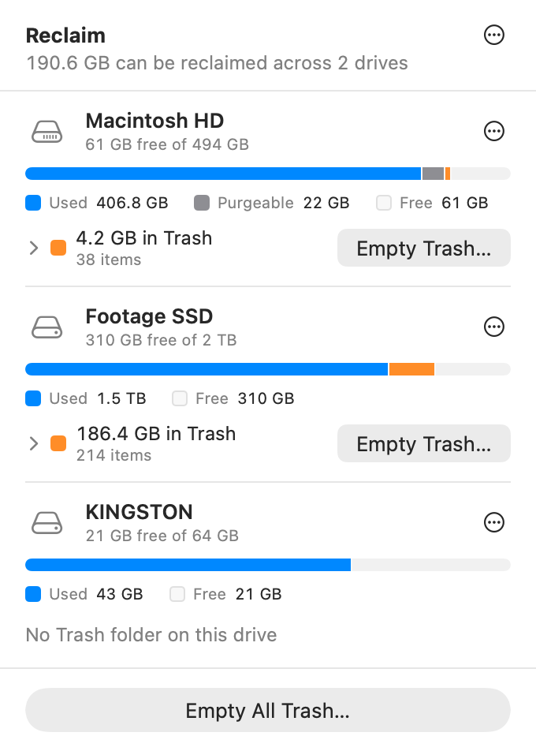
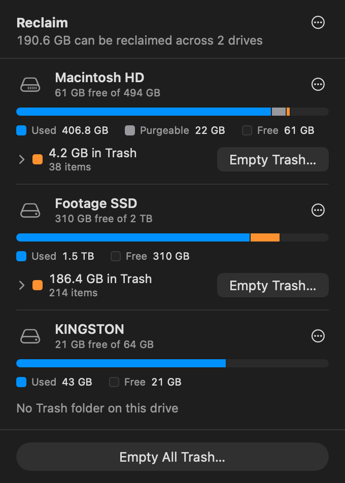

<p align="center">
  
</p>

<h1 align="center">Reclaim</h1>

<p align="center">
  Get your disk space back from the menu bar.<br>
  A free, open-source alternative to CleanMyDrive&nbsp;2 for macOS.
</p>

<p align="center">
  
  &nbsp;
  
</p>

> [!IMPORTANT]
> **Reclaim is in public beta.** It permanently deletes files when you ask it to, and it's built with that in mind (see [what it deletes](#what-reclaim-deletes-and-what-it-never-touches)), but it hasn't yet run on many Macs other than the developer's. Want to help? Read the [beta tester guide](docs/BETA.md).

## Why

When you delete a file on a Mac, it isn't gone. It moves to a Trash folder **on the same drive**: `~/.Trash` for your startup disk, and a hidden `.Trashes` folder on every external drive. The space only comes back when that Trash is emptied, and Finder gives you no easy way to see how much of each drive is in use, waiting in the Trash, purgeable, or actually free.

Reclaim puts all of that in the menu bar and empties any drive's Trash in one click.

## Features

- **Every drive at a glance.** A bar per drive split into *Used*, *In Trash*, *Purgeable* (caches macOS frees by itself) and *Free*.
- **Empty one drive's Trash, or all of them.** Confirmed with a Finder-style alert that tells you exactly how many items and how much space.
- **Trash peek.** See the largest items in a drive's Trash before you erase them. Show any item in Finder (to Put Back), or erase just that one.
- **Remove hidden clutter** from USB sticks and SD cards: macOS's `.DS_Store`, `._` AppleDouble files and temporary items, plus Windows `Thumbs.db` caches, all of which show up on TVs, cameras, car stereos and other PCs.
- **Eject** drives from the same panel.
- **Low-space warnings** when a drive is almost full, telling you how much its Trash would give back.
- **Menu bar badge** showing reclaimable space (above 1 GB by default) and a **global shortcut**, ⌃⌥⌘R by default.
- Native Swift and SwiftUI, no dependencies, Dark Mode, VoiceOver and keyboard accessible.

## Install

1. Download `Reclaim-x.y.z.zip` from [Releases](../../releases) and unzip it. Betas are marked **Pre-release**. To check the download wasn't corrupted or tampered with, download the matching `.sha256` file too and run `shasum -a 256 -c Reclaim-*.zip.sha256` in the same folder.
2. Move **Reclaim.app** to your Applications folder.
3. Open it. Reclaim isn't notarized by Apple yet (that needs a paid developer account), so macOS blocks the first launch:
   - **macOS 15 Sequoia and later:** open **System Settings › Privacy & Security**, scroll to **Security**, and click **Open Anyway** next to the message about Reclaim, then confirm. (Right-click › Open no longer works for this since Sequoia.)
   - **macOS 14 Sonoma:** right-click Reclaim.app, choose **Open**, then confirm.
   - Or, on any version, remove the download quarantine in Terminal:
     ```sh
     xattr -dr com.apple.quarantine /Applications/Reclaim.app
     ```
4. Optional: to see and empty your **startup disk's** Trash, give Reclaim **Full Disk Access**. Click **Open Full Disk Access…** in Reclaim's banner (or open **System Settings › Privacy & Security › Full Disk Access**), turn on **Reclaim**, then choose **Quit & Reopen** when macOS offers it (the banner has a **Restart Reclaim** button if it doesn't). Reclaim is already in the list; if it isn't, click **+** and add it from Applications. External drives don't need it; macOS asks once whether Reclaim may access removable volumes. If you chose Don't Allow, macOS won't ask again: use the **Allow…** button on that drive's row, or turn on Removable Volumes for Reclaim in **Privacy & Security › Files & Folders**.

> Builds are ad-hoc signed by default, so macOS treats each rebuild as a new app and you may need to turn Full Disk Access on again. To keep the grant across rebuilds, sign with a stable certificate you create in Keychain Access (Certificate Assistant › Create a Certificate, type Code Signing), then build with `SIGN_IDENTITY="Your Certificate Name" make app`.

### Uninstall

1. Turn off **Open Reclaim at login** in Reclaim's Settings, then quit Reclaim.
2. Move **Reclaim.app** from Applications to the Trash.
3. Optional: remove it from **System Settings › Privacy & Security › Full Disk Access**, and delete its preferences:
   ```sh
   defaults delete com.akhileshboda.reclaim
   ```

## Privacy

Reclaim has no accounts, analytics, telemetry or crash reporting. Nothing about your files or drives ever leaves your Mac.

It makes one kind of network request: an **update check** against GitHub's public releases API (`api.github.com`), when it opens and once a day after that. Like any web request, that tells GitHub your IP address and that some copy of Reclaim is checking. Turn it off in **Settings › Check for updates automatically**; **Check for Updates…** still works on demand.

**Report a Bug…** opens a GitHub page in your browser with only your Reclaim and macOS version numbers filled in. Nothing is sent until you submit the issue yourself.

## How the numbers work

| Segment | What it is | Source |
| --- | --- | --- |
| **Free** | Space available right now | `volumeAvailableCapacity` |
| **Purgeable** | Caches, iCloud copies and snapshots macOS deletes automatically when it needs room | `volumeAvailableCapacityForImportantUsage − free` |
| **In Trash** | What you deleted but haven't emptied. Reclaim gives this back | Allocated size of the drive's Trash folder |
| **Used** | Everything else | Remainder, so the four always add up to the drive's size |

*Emptied the Trash but the space didn't come back?* On APFS drives, Time Machine local snapshots can keep deleted files' blocks for up to 24 hours. macOS releases them automatically when space runs low (they're counted as purgeable).

## What Reclaim deletes, and what it never touches

Reclaim only ever deletes:
- the contents of a drive's Trash folder (`~/.Trash` or `<drive>/.Trashes/<your user ID>`), when you confirm
- hidden macOS files on **external** drives, when you confirm

Every deletion first goes through one small, heavily tested `SafetyPolicy`:

- The Trash folder must be exactly one of the two locations above. A symbolic link anywhere in its path means Reclaim refuses.
- Each item must be strictly inside that folder. Symbolic links are removed, never followed, so a link in the Trash pointing at your Documents only deletes the link.
- Hidden-file cleanup checks each file's **contents** (the AppleDouble and `.DS_Store` headers), not just its name, and checks again right before deleting. A file of yours that happens to be called `._notes.txt` is left alone.
- On exFAT and FAT32 drives, a `._` file is where macOS keeps another file's Finder tags, comments, colour label and resource fork. Reclaim reads it and **keeps** any `._` file that holds those, or anything it doesn't recognise. It only removes `._` files that are orphaned or hold nothing but download bookkeeping.
- The startup disk and Time Machine backup drives are never "cleaned".

## Build from source

Requirements: macOS 14 or later, Swift 6 (full Xcode **or** just the Command Line Tools).

```sh
make app          # build/Reclaim.app (universal) and build/Reclaim-<version>.zip
make run          # run in sandbox mode (see below)
make test         # unit tests, run inside the test sandbox
make install      # copy to /Applications
```

### The test sandbox

Reclaim deletes files for a living, so its development setup is built to make it impossible to delete the wrong ones:

1. **Throwaway disks.** `Scripts/sandbox.sh up` creates four sparse disk images (APFS, exFAT, FAT32, HFS+, 5 GB of declared capacity in total) and mounts them as real drives named `RTEST-*`. `Scripts/sandbox.sh seed` fills them with trash, locked files, symlinks pointing outside the drive, and junk with decoys. `Scripts/sandbox.sh down` removes everything.
2. **Kernel write sandbox.** Tests and sandboxed app runs execute under `sandbox-exec` with `Scripts/reclaim-test.sb`, which denies writes everywhere except the build folder, the sandbox folder and `/Volumes/RTEST-*`, and explicitly denies `~/.Trash`. A canary check proves this before every run.
3. **Sandbox mode.** `--sandbox` makes the app see only `RTEST-*` drives and never your startup disk's Trash. It also doesn't touch login items, notifications or your preferences.
4. **The SafetyPolicy above**, which is always on.

```sh
Scripts/sandbox.sh up && Scripts/sandbox.sh seed
make test-integration   # the real app model empties, cleans and ejects the RTEST disks
Scripts/sandbox.sh down
```

### Command Line Tools only?

`Scripts/toolchain.sh` (used by every script and Makefile target) detects and works around some rough edges of Command Line Tools-only installs:
- a stale PackageDescription interface that breaks `Package.swift`
- Swift Testing's plugin and runtime paths
- newer SDKs whose SwiftUI `@State` macro plugin ships only with Xcode

With Xcode installed it does nothing.

## Project layout

```
Sources/ReclaimCore   Space accounting, trash scanning and emptying, junk cleanup, SafetyPolicy
Sources/ReclaimUI     SwiftUI views, the app model (testable without a screen) and the brand mark
Sources/Reclaim       AppKit shell: status item, popover, alerts, hotkey, Settings window
Tests/                Swift Testing unit tests, snapshot renders, sandbox-disk integration tests
Scripts/              Build, test sandbox, icon
```

## Brand

The mark is a boomerang: what you throw away comes back. Colours, type, voice and where the mark appears in the app are in [docs/brand.md](docs/brand.md). `make icon` rebuilds the app icon from the same geometry the app draws.

## Roadmap

Ideas for future releases: Clean & Eject in one step, explaining and thinning Time Machine local snapshots, auto-empty rules, Put Back from Trash peek, a command-line tool and URL scheme, a Homebrew tap (the main Homebrew cask list no longer accepts apps that aren't notarized), and signed, notarized builds.

## Support and security

- **Bugs:** choose **Report a Bug…** in Reclaim's menu, or [open an issue](../../issues/new/choose).
- **Reclaim deleted something it shouldn't have:** please [report it privately](../../security/advisories/new) rather than in a public issue. [SECURITY.md](SECURITY.md) explains what happens next.
- **What changed in each version:** [CHANGELOG.md](CHANGELOG.md).

## Contributing

Issues and pull requests are welcome. Please read [CONTRIBUTING.md](CONTRIBUTING.md), especially the safety rules, and the [code of conduct](CODE_OF_CONDUCT.md).

## License

[MIT](LICENSE) © 2026 Akhilesh Boda.

Reclaim permanently deletes the files you ask it to. It's provided as is, without warranty of any kind; the [license](LICENSE) has the full terms. Keep backups of anything you can't lose.

Reclaim is an independent project and is not affiliated with MacPaw or CleanMyDrive.
