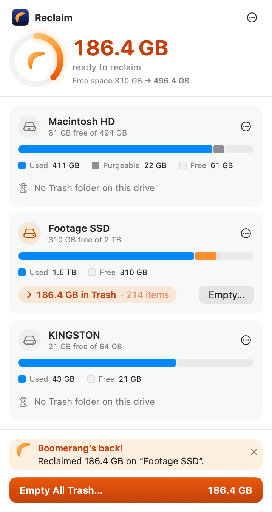
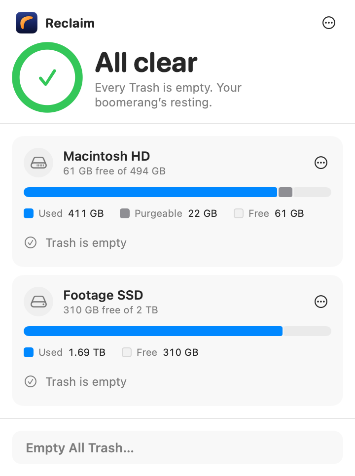

# Reclaim brand

  

## The idea

**Get your disk space back.**

When you delete a file on a Mac it isn't gone: it sits in a Trash folder on the same drive, still taking up room. Reclaim is how that space comes back to you. So the mark is a **boomerang**, the one thing you throw away that's meant to return.

The app icon shows it mid-flight on a night sky, with a dotted trail swinging round from its trailing tip and back to its leading one. The dots grow and brighten on the way home, so the eye reads the direction of travel.

## Mark

- One shape everywhere: the app icon, the menu bar, the badge at the top of the panel, the progress spinner and the "Reclaimed" message all draw [`BrandGeometry.boomerang`](../Sources/ReclaimUI/Brand/BrandGeometry.swift). `make icon` compiles that same file into the icon script, so the icon can't drift from the app.
- The silhouette is a union of discs along one smooth cubic curve, widest at the elbow and tapering to round tips. It reads at 16 px.
- In the menu bar it's a template image, so macOS tints it for light, dark and highlighted menu bars like a system glyph.
- Don't outline it, rotate it, stretch it or put it on a busy background. Give it clear space of at least a quarter of its width.

## Colour

| Name | Hex | Use |
| --- | --- | --- |
| Night | `#0A1030` | Bottom of the icon background |
| Dusk | `#2D4290` | Top of the icon background |
| Ember | `#FF8F24` | The boomerang. The same family as the In Trash segment: orange always means space you can get back |
| Glow | `#FFC46B` | Highlight end of the Ember gradient, and the icon's rim light |
| Deep Ember | `#EC530A` | Shadow end of the Ember gradient |
| Trail | `#A9C4FF` | The flight-path dots |

**Text in Ember.** Plain orange on a light popover fails contrast. The reclaimable amount in the panel header uses `Brand.emberText`: `#C2410C` in light mode (about 5:1 on white) and `#FFA94D` in dark mode.

**Storage segments stay system colours.** Used, Purgeable, In Trash and Free keep `systemBlue`, `systemGray` and `systemOrange` so they follow Increase Contrast and Differentiate Without Colour. The brand doesn't override the user's accent colour either: buttons, toggles and links stay native, with one exception. **Empty All Trash** is the panel's single call to action and is drawn in Ember (a `#EA580C` → `#C2410C` gradient, white text at about 5:1). It's drawn by hand because `.borderedProminent` turns grey whenever the popover isn't the key window.

## Type

- **Wordmark:** "Reclaim" in SF Pro Rounded Bold. The rounded terminals echo the boomerang's tips.
- **Everything else:** the system font, at the sizes macOS uses for popovers and settings. Numbers use monospaced digits so they don't jiggle as drives are measured.

## Voice

Plain, direct and calm. Say what happened and how much: "Reclaimed 186.4 GB on “Footage SSD”." Deleting is permanent, so confirmations, errors and anything about to erase stay exact and never playful.

Wins get a little character, and only wins: the "Boomerang’s back!" headline above a Reclaimed message, and "Every Trash is empty. Your boomerang’s resting." when there's nothing to do. Never "Woohoo! Your drive is sparkling clean!".

## Motion

- Strong curves, not SwiftUI's defaults: ease-out `(0.23, 1, 0.32, 1)` for entrances and value changes, ease-in-out `(0.77, 0, 0.175, 1)` for travel (`Motion` in `Brand.swift`).
- The panel opens often, often from the keyboard, so opening it doesn't animate. Storage bars grow in once, the first time a drive appears, staggered 60 ms per card.
- Hover is a background tint (150 ms), never movement.
- The celebration is the one big moment, because it's rare: after a Trash is emptied an Ember boomerang spins along an arc from the footer back to the hero ring, the ring bounces as it lands, and the amount counts down.
- Under Reduce Motion, nothing travels: no flight, no bounce, no bar growth. Text and colour changes stay.

## In the app

| Where | What |
| --- | --- |
| Menu bar | The boomerang glyph, with the reclaimable amount beside it |
| Panel header | The badge (the icon in miniature) and the rounded wordmark, above the hero: an Ember ring showing how much the drives' free space grows when emptied, the reclaimable amount in large rounded Ember digits, and "Free space 371 GB → 561.6 GB". A green ring with a checkmark means all clear |
| Drive cards | Rounded cards; drives with something to reclaim get an Ember icon and an Ember "in Trash" pill that opens the Trash peek |
| While measuring or emptying | A spinning boomerang. Under Reduce Motion it's the standard system spinner |
| After emptying | The boomerang flies home to the ring, then "Boomerang’s back!" over "Reclaimed …", with an Ember boomerang instead of a checkmark |
| Settings › General | The badge beside the version number |
| About | The icon and the tagline |

  
  &nbsp;
  
  &nbsp;
  

## Files

- `Resources/AppIcon.icns`, `Resources/AppIcon.png`: built by `make icon` from [`Scripts/make-icon.swift`](../Scripts/make-icon.swift)
- [`Sources/ReclaimUI/Brand/Brand.swift`](../Sources/ReclaimUI/Brand/Brand.swift): colours, the badge, the spinner and the menu bar image
- `docs/brand/brand-sheet.png`: the sheet at the top of this page
